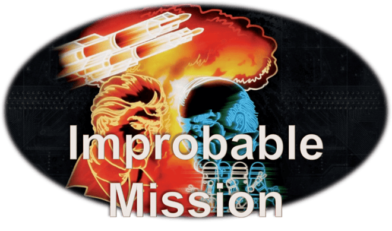
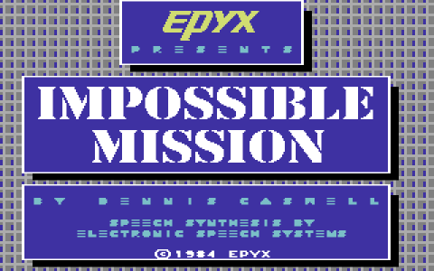
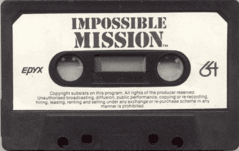
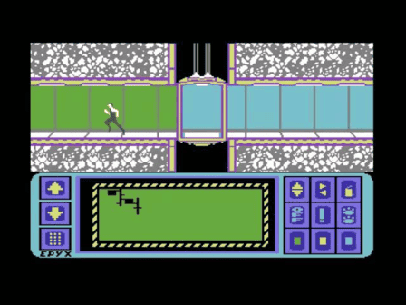
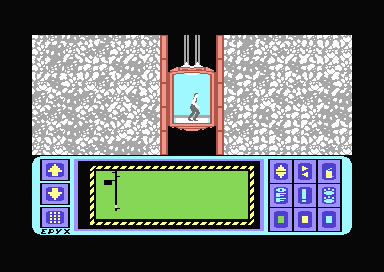

<h1 align="center">
  
</h1>

<p align="center">
  <em>"Stay awhile ... stay forever!"</em>
</p>

In 1984, a maniacal villain taunted players from their Commodore 64 screens, and ["Impossible Mission"](https://en.wikipedia.org/wiki/Impossible_Mission) became an instant classic. With its groundbreaking digitized speech, acrobatic platforming, and race-against-time puzzle-solving, this game captivated a generation of gamers on the C64, ZX Spectrum, and other home computers of the era.

<p align="center">
  
</p>

This game was published by [Epyx](https://en.wikipedia.org/wiki/Epyx) back in 1984.

<p align="center">
  <br>
  
</p>

This repository is my attempt to bring that iconic experience to the modern web through a JavaScript reimplementation. My slight renaming of the game here is to ensure I avoid any suggestions of infringement. The use of "improbable" also reflected the likelihood of my actually being able to reproduce this game, particularly in JavaScript.

Whether you're chasing nostalgia or discovering this gem for the first time, prepare to infiltrate the villain's stronghold, dodge deadly robots, and piece together a fiendish puzzle.

As the game manual stated, _"Good luck. The world is depending on you."_

## 🤖 The Mission Is ...

<p align="center">
  <br>
</p>

The premise of the game is simple. You are Agent 4125 and you must find all of the key cards hidden throughout the hideout of Professor Elvin Atombender, fit them together, and use them to unlock his secret lair where you can stop his plans for world destruction.

<p align="center">
  
</p>

The game combines some difficult platform jumping, puzzle solving, and exploration in one package. Without doubt the game does rely on some quick reflexes. The game also featured several different layouts, as well as other randomized elements, to vary the game playing experience.

<p align="center">
  
</p>

I also have a copy of the <a href="./assets/impossible-mission-manual.pdf">original manual</a> for the game should you wish to check it out.

## 🕹️ Playing

You have six hours (the clock on your pocket computer runs from 12:00 to 6:00) to find Elvin's control room password and open his door. The loop:

1. **Explore.** Ride the elevators (up/down while standing in one) and
   run through corridors into rooms (arrow keys). Your pocket computer
   at the bottom of the screen maps everywhere you've been.
2. **Survive.** Robots patrol and zap; the black orb pursues; the
   bottom of some rooms is a long way down. Jump with **Shift**, **Space**,
   or **Ctrl** — a somersault with a running start, or a standing jump in
   place. Ride striped lifting platforms with up/down while standing on
   them. Every death costs **ten minutes**.
3. **Search.** Stand in front of any furniture and hold **up** until
   the progress bar empties. You'll find nothing (the object vanishes),
   a **snooze** (temporarily disables a room's robots), a **lift init**
   (resets a room's platforms), or a **puzzle piece** (filed into your
   pocket computer). Spend snoozes and lift inits at the security
   terminal in each room (stand in front, press up).
4. **Solve.** Press fire while standing in an elevator to switch to
   the pocket computer's puzzle desktop. Move the glove with the arrow
   keys and press fire to click: scroll the memory window for pieces,
   drop them onto the desktop, and stack pieces of the same puzzle —
   flipped right and matching in color — to merge them. Four merged
   pieces form a punch card and add one letter to the password; nine
   solved puzzles spell all nine letters. The buttons along the bottom
   flip a piece vertically or horizontally, trash it, recolor it,
   undo, pause, or dial the phone — which can orient the two pieces in
   the memory window or check whether the held piece's puzzle is
   solvable, at two minutes a call.
5. **Bonus.** Two music rooms hold an organ: press up at the console
   and click the flashing squares in ascending note order for extra
   snoozes and lift inits.
6. **Win.** With the full password, find the door in one of Elvin's
   bedrooms, stand in front of it, and push up.

Scoring at the end: 1 point per second remaining, 100 per puzzle piece,
100 per snooze/lift-init found, 500 per puzzle solved, 1000 for
completing the mission. **P** pauses; the toolbar switches between six
C64 monitor palettes, recoloring every sprite at the pixel level.

The full mission dossier — the in-game manual with illustrations — is
under **Dossier** in the toolbar.

## Cheat Codes

Type a code word on the keyboard during play to toggle it (a banner
confirms; type it again to turn it off):

- **`STAYFOREVER`** — invincibility: robots and the orb can't zap you.
- **`AIRWALK`** — you never fall: walk straight across gaps.
- **`TIMELORD`** — the clock freezes: no ticking, no phone charges, no
  death penalties.
- **`XRAY`** — the pocket computer shows the entire map, explored or
  not (your real exploration state is untouched).

A game in which any cheat was used still shows its final score, but is
not entered into the persisted hall of fame. For testing, cheats can
also be enabled at load with `?cheats=stayforever,airwalk`.

A `?map=N` query parameter (0-10) forces a specific tower layout for
testing.

## 🏗️ How the Code Fits Together

If you're reading the source rather than playing, start here. There is
no framework and no build magic beyond Vite: just TypeScript modules,
a canvas, and one sprite sheet.

### Booting

`index.html` loads `src/mission.ts`, which shows the landing page and
waits for **ACCEPT THE MISSION**. That click unlocks the `AudioContext`
(browsers won't start audio without a gesture), runs the opening crawl,
and then calls `engine.init()`. The engine loads the sounds, the sprite
sheet and the C64 font, wires up the toolbar, calls `game.init()` to
build the stronghold, and starts the two loops.

### Two loops, two clocks

This is the one piece of architecture worth understanding before
anything else, because putting code in the wrong loop is the bug the
design invites:

| Loop | Driven by | Advances | Owns |
| --- | --- | --- | --- |
| **scan** | `setInterval`, fixed **27ms** | scan frame counter (SFC) | game logic: physics, input, robots, the clock |
| **animate** | `requestAnimationFrame`, throttled to ~**30ms** | animation frame counter (AFC) | drawing only |

The scan interval is fixed, so the SFC *is* the game's measure of time —
37 of them come to 999ms, which is where the mission clock's "tick a
second every 37 frames" comes from. Rendering is allowed to slip when
the browser is busy, so the AFC only drives how things *look*: sprite
cycling, blinking, flashing. Anything paced off the AFC runs at a
machine-dependent rate, which is fine for a blink and wrong for a robot.
Both counters live in `common/gameTime.ts` so components can read them
without importing `Game`.

### Modules

Systems are module singletons — `export const game: Game = new Game()`
— imported directly wherever they're needed. There's no dependency
injection and no service locator; `import { game }` is the whole story.
The exceptions are the things a stronghold has many of: `Room`,
`Robot`, `Orb`, `Furniture`, `Terminal`, `InnerLift` and `Puzzle` are
ordinary classes, instantiated per room.

| Directory | What's in it |
| --- | --- |
| `src/` | `mission.ts` (entry), `engine.ts` (loops), `game.ts` (state, scene dispatch) |
| `src/common/` | shared systems: audio, input, scenes, time, layout, cheats |
| `src/component/` | the game objects — agent, rooms, robots, lifts, terminals, the pocket computer |
| `src/data/` | tables ported from the original, plus the sprite sheet regions |
| `src/types/` | shared types; `layout.ts` is the legend for the data tables |
| `src/ui/` | DOM-side chrome: toolbar, palette and sound pickers, fullscreen, the crawl |
| `src/utils/` | canvas drawing, sprite loading, palette math, logging |

### Coordinates

Four systems are in play, and confusing them is the other easy mistake:

- **Character cells** — the C64's 8×8 text grid; a room is 40×25. Most
  placement data in `data/layout.ts` is in cells.
- **Logical pixels** — the C64's 320×200 screen. Everything you pass to
  `utils/graphics.ts` is in these.
- **Canvas pixels** — 960×600. `graphics` multiplies logical pixels by
  3 on the way out, and nothing outside that file knows the real size.
- **Sprite sheet pixels** — offsets into `public/images/sprites.png`
  (800×600), named in `data/spriteRegions.ts`.

So a platform at `x: 4` is cell 4, logical pixel 32, canvas pixel 96 —
and only the first two ever appear in game code.

### Colors are indices

Nothing in the game names a color. Every color is an index into a
16-entry C64 palette, and the toolbar swaps which palette those indices
resolve against, recoloring the sprite sheet pixel by pixel at runtime
(`utils/paletteUtils.ts`). That's why the same room reads differently
under VICE and Colodore, and why `roomColors` is a table of numbers.

### The data is the original's data

`src/data/layout.ts` is the 32 rooms, 11 layouts, platforms, furniture,
lifts and enemies.

### Tests

```
npm test          # unit suite (vitest)
npm run check     # typecheck
npm run test:visual   # canvas snapshots, needs npm run build first
```

The unit suite covers the data tables and the pure functions.
`tests/originalParity.spec.ts` is the interesting one: it loads the
original `constants.js` from a copy of the original disassmebly that
I used alongside more work and diffs every ported table against it,
skipping itself when that copy isn't there.
`tests/publicAssets.spec.ts` covers a different weak spot: every asset
is loaded by string rather than by import, so a renamed file breaks the
game at runtime while leaving the build green. It checks that every
reference resolves and that no image sits unreferenced. `tests/visual/`
renders the game in headless Chromium and compares the canvas pixel for
pixel; see its README for how the captures are made deterministic.

### Deploying

`.github/workflows/deploy.yml` publishes the site to GitHub Pages on
every push to `main`: install, run the unit suite, build, then hand
`dist/` to the Pages deployment.

The one thing worth understanding is the base path. The site is served
from a subdirectory (`/improbable-mission/`) rather than a domain root,
so every URL has to carry that prefix. Two mechanisms cover that:

- `base` in `vite.config.ts` rewrites the URLs in `index.html` at build
  time.
- `import.meta.env.BASE_URL` prefixes the ones that are built at runtime
  — the sprite sheet, the audio files, the crawl music.

Both read from the same setting, so there is one place to change if this
ever moves. The workflow also checks the built output against the path
Pages reports, because a repository rename would otherwise break every
asset URL while leaving the build green.

The pixel-snapshot suite does not run in CI. Its baselines are tied to
the machine that captured them, and a runner's font rasterisation
differs enough to fail for reasons unrelated to the code.

## 🙏 Attributions

- **Original game**: Dennis Caswell / Epyx, 1984. Disassembled.
- **JavaScript implementation**: this project is a TypeScript recreation, built from scratch, inspired by the 2013 vanilla-JS remake by [Krisztian Toth](http://krissz.hu/). Unfortunately, he never released his source code, so this isn't a port of it; it's what I was able to recreate from observing and playing that version compared to the disassembled original. As I found, there were a lot of bugs in this implementation, so I didn't follow it too much.
- **Defold implementation**: this project, referred to as [C64 Impossible Mission Tribute](https://github.com/acapitani/im), uses the Defold game engine. The room implementation data model was useful to understanding how the game worked and the logic overall gave me an independent source from the disassembled original.

## 👨‍💻 Author

<p align="center">
  Made with 🤍 by <a href="https://github.com/jeffnyman">Jeff Nyman</a>
</p>

<p align="center">
  
</p>

<p align="center">
  <a href="https://testerstories.com" target="_blank" >
    
  </a>
</p>
<p align="center">
  <a href="https://www.linkedin.com/in/jeffnyman/" target="_blank" >
    
  </a>
</p>

## ☦️ Doxazein (δοξάζειν)

<p align="center">
  חֶסֶד וֶאֱמֶת אַל־יַעַזְבֻךָ קָשְׁרֵם עַל־גַּרְגְּרֹתֶיךָ כָּתְבֵם עַל־לוּחַ לִבֶּךָ
</p>

<p align="center">
"Let not mercy and truth forsake thee:<br>
bind them about thy neck;<br>
write them upon the table of thine heart."<br>
<em>Proverbs 3:3</em>
</p>

## ⚖️ License

The code used in this project is licensed under the [MIT license](https://github.com/jeffnyman/improbable-mission/blob/main/LICENSE).

**Note:** The MIT license covers the original code in this repository only. It is not a license to *Impossible Mission*, its name, characters, or other intellectual property. That game was originally developed by Dennis Caswell and published by Epyx in 1984; when Epyx went out of business, the rights to its back catalog were acquired by System 3, which owns the copyright and IP rights to *Impossible Mission* today. None of that is granted by, or affiliated with, this project. It also doesn't extend to the licensed third-party music, sound effects, tilesets, and sprites listed above under Attributions, which remain under their own separate terms.

✨ Long live the classics.
