# 📐 Sprites

## 🕰 The Making of a Spritesheet: A Retro Artifact Narrative

First, let's consider this game's sprite sheet:

<p align="center">
  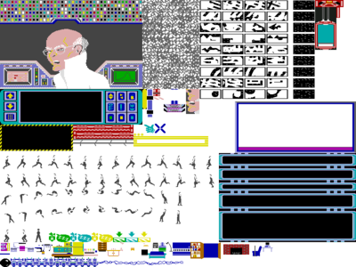
</p>

This is an 800x600 sprite sheet. (The copy above is a half-scale export so it sits comfortably on the page; the file the game actually loads is `public/images/sprites.png`, at full size.) That sprite sheet isn't just a collection of pixels; it's a reassembled visual language from *Impossible Mission*, originally released in 1984 for the Commodore 64. In its original context, none of these frames existed together in this tidy grid. Instead, they were distributed fragments inside the game's memory, summoned and layered dynamically as the game played.

I can't stress that point enough: the original 1984 game didn't have a "sprite sheet" like this at all. Graphics were stored in memory-efficient formats specific to the Commodore 64's VIC-II chip. The above PNG is a reconstruction based on that underlying data. Basically, I extracted the graphics data from the original Commodore 64 game files.

A sprite sheet is basically a single image file that contains many smaller images, usually all the different frames or poses of a character or object in a game.

<p align="center">
  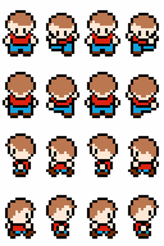
</p>

One frame might show the character standing. Another might show them running or flipping. Another might show a door opening, a robot firing, or a platform moving. Instead of loading dozens of separate images at runtime, the game engine just references different regions of this one big image.

## 🧩 Step 1: Excavating the Past

I began with the game running in an emulator like VICE. Using sprite and tile viewers, I could pause the game, expose the raw graphics stored in memory, and export individual sprite images. Alternatively, I could open the game's ROM in a tile editor like [Tile Molester](https://www.romhacking.net/utilities/109/) or [YY-CHR](https://www.romhacking.net/utilities/119/). Those editors open a file as a grid of 8x8 character cells, which is the format the C64 used for text and background tiles. Set the codec to the C64's multicolor format and the row width to 24 pixels, though, and the other format the machine understood falls out of the noise: the 24x21 bitmap that was the fixed hardware sprite size.

Each exported frame -- whether of the main character, a robot, a terminal, or background tile -- was once a tiny programmatic ghost, existing only briefly as the game called it. Here, those ghosts are captured, cropped, and preserved. This kind of sprite extraction is a lot like reconstructing an artifact from scattered shards. You’re not just "ripping" art; you're reverse-engineering a design language:

- How the game reused tiles to save memory.
- How animation frames were optimized for speed.
- How illusion of movement was created with minimal resources.

In a way, a sprite sheet is like finding the Rosetta Stone of a game's visual system. It reveals how the developers communicated visually with so little.

## 🧭 Step 2: Reassembling the Fragments

Once extracted, the raw sprite frames get arranged in an image editor like GIMP or Aseprite. This step mirrors how archaeologists lay out shards of pottery on a table to reconstruct a vessel's shape. I grouped together:

- UI elements and terminals,
- background patterns and wall tiles,
- icons,
- and most notably, the agent animation frames, which are the visual heartbeat of the game.

The layout is not arbitrary, by the way! It's functional. Frames sit on a regular pitch so a modern engine can slice them by arithmetic instead of by lookup — the agent's frames, for instance, step across in exact multiples of 35 pixels, which is why the animation table in `agent.ts` only ever records a corner for each frame and never a size.

## 🕺 Step 3: The Story Behind the Size Differences

One of the most striking features of this sprite sheet is how much the agent's drawn figure varies from frame to frame. The cells are uniform — every agent frame occupies a 35x41 box, laid out on a 35-pixel pitch, which is why the engine can draw all of them with a single `AGENT_FRAME_SIZE` — but the ink inside those cells is not. Measured off the sheet, a running frame is anywhere from 13x29 to 24x29; the standing pose is a narrow 12x28; halfway through a somersault the figure flattens out to 30x14 and then stretches to 15x31 on the way down. You can grab the image and take a look at it in [Sprite Splitter](https://tools.spriters-resource.com/#sprite-splitter). At first glance, this might look inconsistent. But, in fact, it's the key to understanding how *Impossible Mission* achieved its famous fluid somersault animation. The fluid somersault animation was so technically impressive in 1984 that it's often remembered as the game's visual signature. The movement looked almost rotoscoped compared to the stiff 2-frame animations common at the time. What I found digging into this was:

- Multiple sprites were stacked.
- Transparent padding was used cleverly.
- Timing and offsets were finely tuned.

So what you're seeing with those varied dimensions isn't an artifact of bad ripping, which I initially thought it was. It's a historical footprint of the animation techniques that made the game stand out.

### 🧠 Why the Sizes Vary So Much

The Commodore 64's sprite canvas was fixed at 24x21 pixels, but the drawn silhouette inside that box varied from frame to frame. I realized this was based on the following:

- Running and standing, the figure fits comfortably within a narrow, compact shape.
- Leaping and flipping, the limbs extend outward, increasing the width and height.
- Landing or crouching, the figure collapses into a short, wide profile — 24x22 at the moment of touchdown, against 15x31 in the air a few frames earlier.

And, again, each of these differences contributes to an illusion of natural, continuous motion, far beyond the typical 2-frame "walk cycles" of many early '80s games.

### 🧰 Sprite Composition Tricks on the C64

Developers got around hardware limits by using clever composition strategies:

- Offset positioning: Even though the sprite’s canvas was fixed, they could shift where it was drawn on-screen, keeping the character’s logical position constant while the visible pixels moved.

- Multi-sprite overlays: For bigger poses like the somersault, they stacked multiple hardware sprites — for example, one sprite for the torso, another for extended legs or arms. This let them break out of the 24x21 constraint while still working within the system’s rules. The sheet still carries the evidence: the flattest somersault frame measures 30 pixels across and the tallest reaches 31 pixels down, and neither of those fits in a 24x21 box at full resolution. Whatever drew them was more than one sprite.

- Color tricks: Overlaying sprites also allowed for more color variety than a single sprite could support.

These techniques were invisible to the player, but they're what gave the game its signature visual fluidity.

### 🪞 Why the Spritesheet Keeps the Canvas, Not the "True Shape"

There are two ways a sheet like this can be built. You can crop every frame down to its visible silhouette, which saves space and shows you the pose honestly, but then every frame needs an offset recorded somewhere so the renderer knows where to put it. Or you can leave each frame sitting in a uniform box with its transparent padding intact, and let the padding carry that information instead.

This sheet does the second thing, and it took me a while to appreciate why that was the better trade. Every agent frame lives in the same 35x41 cell, and where the figure sits inside that cell is not decoration — it's data:

- All fourteen running frames have between zero and two pixels of empty space below the feet, so every one of them stands on the same line.
- The airborne somersault frames float as much as twenty-six pixels above the cell floor, which is correct, because at that point in the jump the agent genuinely is off the ground.
- The left-facing frames are padded on the opposite side from the right-facing ones, so a turn doesn't shift the figure sideways.

Here are ten cells lifted straight off the sheet, each drawn in its own 35x41 box (red), with a single ground line (blue) laid across the bottom of each row and a pivot tick (green) at the bottom center of every cell:

<p align="center">
  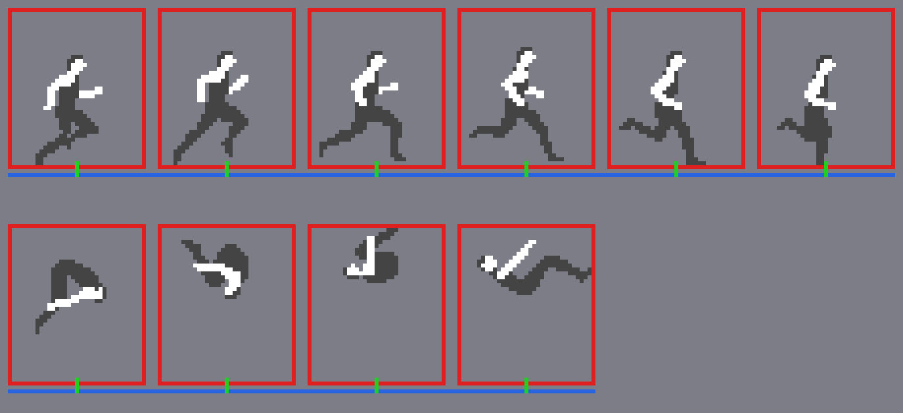
</p>

The top row is the first six frames of a run, and every one of them plants its feet on that line without a single offset being recorded anywhere. The bottom row is four frames from a somersault, and they float — which is the point. Nothing had to tell them to float. It's just where the figure was sitting when the cell was cut.

That is the whole alignment system, baked into the image. It's why the engine can draw any pose the agent can strike with one call and no lookup table:

```ts
graphics.draw(
  agentImage.x,
  agentImage.y,
  AGENT_FRAME_SIZE.w,
  AGENT_FRAME_SIZE.h,
  this.x,
  this.y + this.correctY,
);
```

That's from `src/component/agent.ts`, and the one correction in it, `correctY`, isn't a per-frame alignment offset — it's the jump arc, the handful of pixels that pull the agent onto a platform he's about to land on.

An analogy I reached for when developing this was that it's like photographing dancers on a fixed stage and keeping the whole stage in every shot. You could crop to the dancer, but then you'd have to write down where they were standing. Keep the stage and you don't have to: stack the photos and the floor never jumps.

(The individual frame images further down this page are cropped the other way, to 24 pixels wide by 42 or 63 tall — two or three stacked hardware canvases. Those are working files I made to reason about the alignment, not what the sheet stores.)

## ⚙ Step 4: Modern Reinterpretation

In a contemporary remake, these varying poses have to be harmonized somehow, and it's worth being precise about which way this project does it.

The textbook approach is to store each frame cropped, give it a pivot at the character's feet, and carry a per-frame offset table so the renderer knows where to place it. This project doesn't need that table, for the reason described above: the offsets are already in the sheet, spelled as padding. What the port does own is the timing — fourteen phases for a run, twelve for a jump, and the rule in `agent.ts` that agent logic only advances on even scan frames, which is what puts the animation back at the original's cadence rather than at whatever speed a modern machine would run it.

The result is that the agent moves fluidly on-screen even though the drawn shapes differ wildly from frame to frame, just as he did in 1984.

## 🏺 Step 5: A Living Artifact

What everything led up to is that the sprite sheet, then, isn't just a technical tool. It's a cultural artifact. It captures:

- The constraints and ingenuity of early game development,
- The aesthetic logic of animation before modern engines,
- And the labor of someone decades later who reverse-engineered a design language to bring it into the present.

Where once these sprites flickered one at a time in low-resolution glory, they now sit side by side: a complete lexicon of movement, interface, and environment, ready to be reanimated. Here are four poses lifted out of those cells and cropped the old way instead — down to the hardware canvas (red) rather than to the engine's 35x41 box. The line across the middle of each is where one 24x21 sprite ends and the next begins, and the green tick is the pivot at the bottom center.

<table align="center">
<tbody>
<tr>
<td>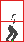</td>
<td>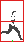</td>
</tr>
<tr>
<td></td>
<td>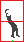</td>
</tr>
</tbody>
</table>

These visualizations show how the drawn silhouette sits inside a fixed hardware boundary, with all four of these frames extending into multiple stacked sprite regions.

- 🟥 Red box = original hardware canvas (24×21 px per sprite, extended vertically if stacked).
- 🟩 Green line = foot pivot reference point (used to align animation despite size variation).

This illustrates:

- How not one of these poses fits in a single 24×21 canvas. Standing is 12×28; the running stride is 24×29; the crouch at the start of a jump is 24×22; coming out of the flip is 15×31. Every one of them needs a second sprite stacked underneath.
- How the drawn shape swings from 12 pixels wide to 24, and from 22 tall to 31, inside a container that never changes.
- How the pivot sits at the bottom center of the stack, so it stays put while the shape changes around it.

Here are the same four frames with a ground line added (in blue), showing how the character’s feet consistently align even as the sprite shape changes dramatically from frame to frame:

<table align="center">
<tbody>
<tr>
<td>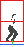</td>
<td>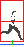</td>
</tr>
<tr>
<td></td>
<td>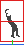</td>
</tr>
</tbody>
</table>

- 🟦 Blue line = ground reference
- 🟩 Green tick = foot pivot
- 🟥 Red box = original sprite canvas (single or stacked)

This ground reference reveals a key trick used in *Impossible Mission*:

- Frames of different dimensions were anchored to a stable position, not the top-left corner of the sprite box.
- This avoided the "jittering" that would occur if each frame were simply drawn from its origin.
- It's also why when you replay the original game, the agent's feet glide smoothly across the floor, even during those signature somersaults.

Which is the same job the 35x41 cells do on the sheet this project ships — the difference being that the cells solve it once, in the image, instead of once per frame in a table.

Here is a way to combine the frames.

<p align="center">
  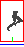
</p>

This short sequence illustrates how the sprite frames, despite their differing widths and heights, share one anchor, so the sequence doesn't skate around while it plays. This is essentially the same principle that allowed *Impossible Mission* to achieve its impressively smooth animation for its time. Here's the full somersault animation assembled from the individual sprite frames I eventually created:

<p align="center">
  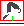
</p>

- 🟥 Red box = original sprite canvas (24×21 px per sprite, stacked as needed)
- 🟩 Green tick = pivot point (feet alignment)
- 🟦 Blue line = ground reference

Notice how even as the figure rotates dramatically through the air, the pivot remains anchored to the same ground plane. This was key to Impossible Mission’s famously smooth animation. It's a textbook example of pose variability within fixed hardware constraints.

In all, the sheet carries fifty-five agent cells: fourteen running frames and twelve jumping frames in each direction, two standing frames, and a single search pose that both directions share. Falling gets no art of its own — it reuses running frame 5, the one where both legs are together. You can read the whole layout off the frame table at the top of `agent.ts`: the runs sit at y=339 and y=380, the jumps at y=421 and y=462, and everything else shares the row at y=503.

The working set I measured while sorting out the alignment was fifty exported frames, and what I did with them was:

- Align all 50 frames on a consistent pivot.
- Draw a ground line across frames.
- Add box outlines to each frame.

A little more specifically:

- Use the bottom center of each frame's canvas as its pivot — which is the same thing as the feet, for any frame where the agent is standing on something.
- Place all frames so their pivots sit on the same Y-coordinate.
- Draw a horizontal ground line in blue at that pivot level.
- Draw a red rectangle around the actual pixel content of each sprite.
- Keep transparent padding visible to see how much space each frame uses.

Note that the red box means something different here than it did in the still frames above. There it was the hardware canvas, fixed at 24 wide and stacked in multiples of 21 tall. Here it's drawn tight around the ink, so it changes shape from frame to frame — 17x29 for the first running pose, 30x14 at the flattest point of the somersault. That's the whole reason for drawing it this way: you want to watch it move.

The result:

- Blue line for ground
- Red box for sprite content
- Transparent padding visible

I also added a 1-pixel offset upward to keep the ground line visible even when the character is standing flat. As I learned, this is apparently a common trick to avoid the blue line "touching" the feet visually.

<p align="center">
  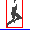
</p>

You should now be able to:

- clearly see the blue ground line anchoring all frames,
- watch the red bounding boxes expand and contract through different poses, and
- track how the sprite maintains stable pivot alignment during running and somersaulting.

I generated a [frame-by-frame metrics table](./assets/sprites/agent-frame-metrics.csv) with the exact dimensions and alignment data that I used for the debug GIF (bottom-pivot with a 1-px upward offset). 
